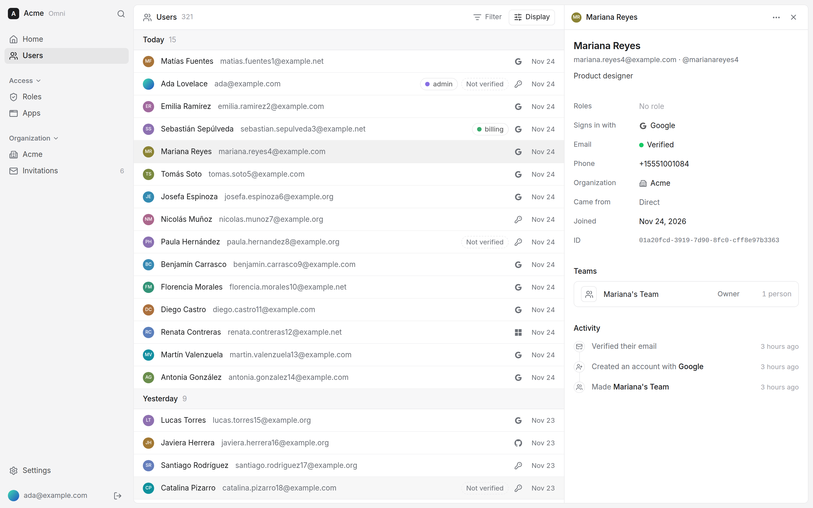
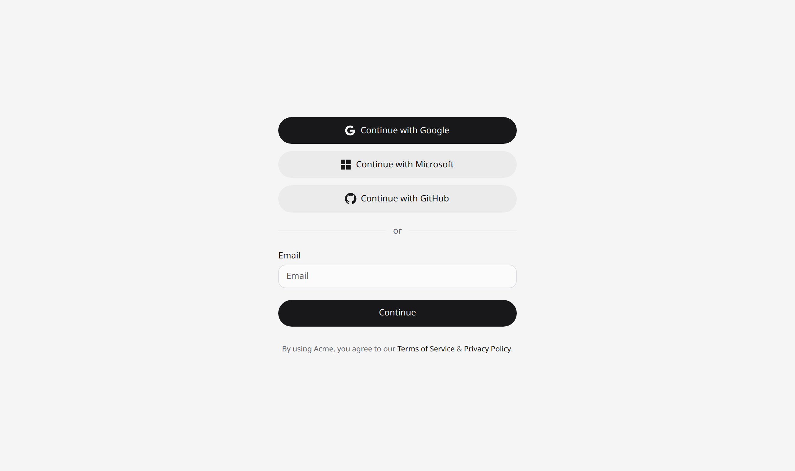
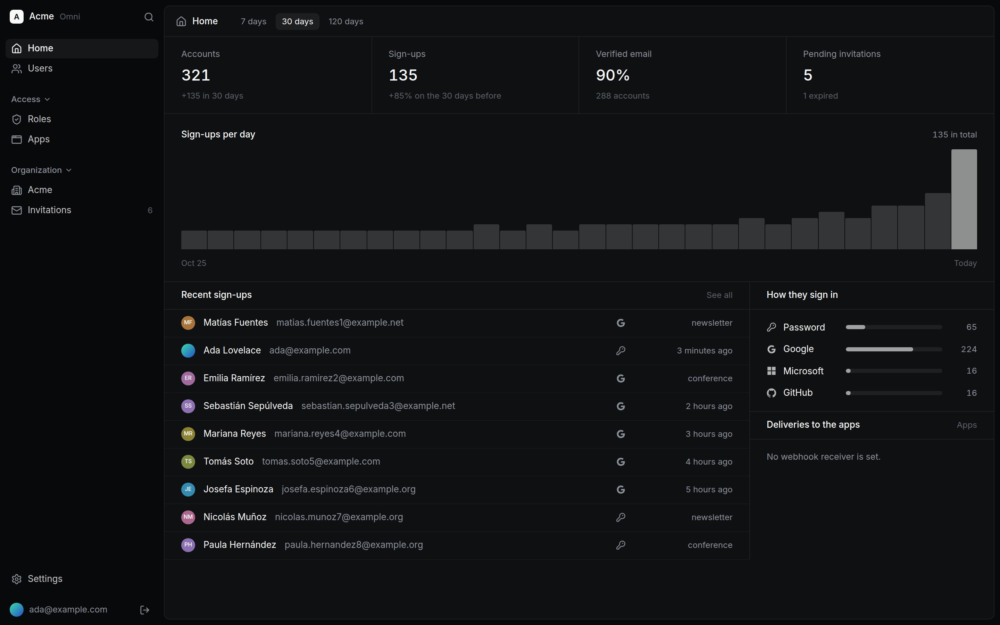

# Omni

Omni is a self-hosted identity service for one product. It holds your accounts (email and password,
Google, GitHub, Microsoft), organizations, teams and invitations, runs the sign-in pages, and hands
each of your apps a signed session. Omni knows nothing about the product it serves: the name, the apps,
the providers and the mail all come from environment variables.



| Sign-in | Console home |
|---|---|
|  |  |

## What you get

- **Sign-in pages** for email and password, Google, GitHub and Microsoft, plus sign-up and password
  reset, in English and Spanish.
- **Sessions your backend can trust**: HS256 JWTs signed with a secret you share. Changing or resetting a
  password, or removing the account, signs that person out everywhere.
- **A directory API** your backend calls with a service key: users, roles, organizations and teams.
- **Signed webhooks** when something changes: `user.created`, `user.removed`, `session.revoked` and more.
- **A console at `/admin`** for anyone holding the `admin` role. It shows accounts, roles, the
  organization, the apps and the settings, and can grant roles, send reset links, sign someone out and
  delete accounts.

## Deploy with Docker

You need Docker with Compose. The stack runs Postgres 18, Redis, the api and the web behind nginx.

**1. Configure it.**

```sh
git clone https://github.com/Pollium/Omni.git omni && cd omni
cp .env.example .env
```

Fill in `.env`. Generate each secret with `openssl rand -hex 32`:

```sh
POSTGRES_PASSWORD=…
JWT_SECRET=…                 # your backend verifies sessions with it
SERVICE_KEY=…                # your backend's key for the directory; it also signs webhooks

NAME=Acme                    # shown on the sign-in pages and in every mail
WEB_URL=http://localhost:8090
API_URL=http://localhost:3001
APPS=[{"id":"web","url":"http://localhost:5173"}]
```

`APPS` lists your product's frontends. The first one is home. Leave the OAuth, SMTP and webhook
variables empty until you need them; a provider shows on the sign-in page once both its id and its
secret are set.

**2. Start it.**

```sh
docker compose up -d --build
```

The sign-in site is at `http://localhost:8090` and the api at `http://localhost:3001`. The ports come
from `OMNI_PORT` and `OMNI_API_PORT`.

**3. Make yourself an admin.** Open `http://localhost:8090/admin` and create your account. Then give
it the `admin` role and reload the page:

```sh
docker compose exec postgres psql -U omni -d omni \
  -c "update \"user\" set roles = array_append(roles, 'admin') where email = 'you@example.com'"
```

### In production

- Put the web and the api behind HTTPS, and set `WEB_URL` and `API_URL` to their public addresses.
- Register `${WEB_URL}/auth/oauth/<google|github|microsoft>/callback` as the redirect URL with each
  provider.
- Set `SMTP_HOST` (and the rest of `SMTP_*` and `MAIL_FROM`). Without it, mail only goes to the log,
  so reset links and invitations never arrive.
- Keep `JWT_SECRET` when you move the database. A new secret ends every open session.

## Connect an app

1. Your app makes a PKCE pair and sends people to
   `${WEB_URL}/continue?app=<id>&challenge=<challenge>&next=<path>`.
2. Omni signs them in, or creates the account, and returns them to `<app url>/auth/callback?code=…`.
3. Your app trades the code and its verifier for `{ token, user }` with
   `POST ${API_URL}/auth/oauth/exchange`.
4. Your backend verifies the token with `JWT_SECRET` and reads the directory with the `x-omni-key`
   header.

The whole protocol, with copyable snippets, is in [.agents/integrating.md](.agents/integrating.md).

## Develop

```sh
pnpm install
cp packages/apps/api/.env.example packages/apps/api/.env   # fill JWT_SECRET and SERVICE_KEY
pnpm dev                                                   # Postgres, Redis, api :3001, web https://localhost:5176
pnpm typecheck && pnpm lint && pnpm test
```

[AGENTS.md](AGENTS.md) maps the code and links the guides for the api, the web and the tests.
